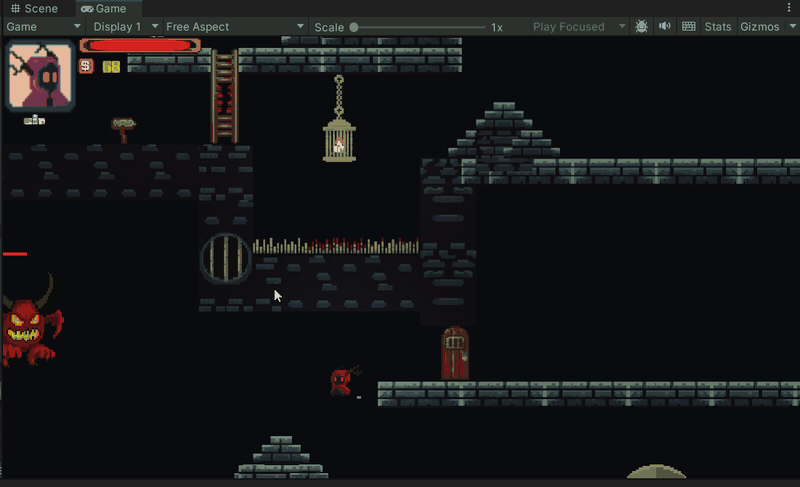

# 🗡️ Project Dash —— Unity 2D 动作游戏 Demo

> 个人独立开发。重点在 **底层架构**（Lua 热更新状态机 / 数据驱动）与 **手感调优**（打击感 / 跳跃 / Boss 节奏）。
>
> 规模：**94 个 C# 文件 / 约 7900 行** + **24 个 Lua 文件 / 约 860 行**，可完整出包运行（Windows）。

## 🎮 实机演示



*上面是 12 秒精华切片（飞行 Boss / 下坠警示圈 / 伤害数字 / 打击特效）。*

▶ **[完整演示视频（B站）](这里换成你的 B站链接)**

---

## 🕹️ 操作

| 按键 | 功能 |
|---|---|
| `A / D` | 移动 |
| `Space` | 跳跃（按住跳更高） |
| `S + Space` | 穿过单向平台 |
| `W / S` | 上下爬梯 |
| `K / 鼠标左键` | 攻击（长按连击） |
| `Shift` | 冲刺（有无敌帧） |
| `Q` | 切换武器 |
| `B` | 打开背包 |
| `E` | 交互（开箱 / 看告示牌 / 商店 / 开门） |
| `F1` | 调试：显示所有战斗范围（编辑器） |
| `Esc` | 退出 |

---

## 🚀 技术亮点

### 1. 玩家状态机完全 Lua 化（xLua 热更新架构）★

玩家的行为逻辑**不是 C# 状态机**，而是运行在 Lua 虚拟机里的**三层并行 HFSM** —— 改行为不用重新编译、不用重新出包。

**三层并行结构**（`Assets/StreamingAssets/Lua/Framework/Fsm/HFSM.lua`）：

| 层 | 语义 | 状态 |
|---|---|---|
| `BASE` | 常驻层，永远有一个 current | `ground` / `air` / `ladder` |
| `ACTIVE` | 瞬态层，与 BASE 并行 | `attack` / `dash` |
| `ABNORMAL` | 独占层，激活时冻结其它两层 | `hurt` |

**几个关键设计**：

- **跨层切换**用 `{layer=, name=}` 返回，瞬态层切走时自动 `Exit + 清空`（`{}` = 只清空本层）
- **MUTEX 互斥**：冲刺期间锁住 BASE 层的位移输出，但**落地/离地检测照常执行** —— 因为"落地"是物理事实，不该被状态锁屏蔽
- **C# 只提供能力，不写逻辑**：`PlayerController` 暴露 `PlayIdle/PlayMove/PlayJump/PlayDash/PlayHurt/PlayAttack` 等安全播放入口（内部 `Animator.HasState` 校验，状态不存在时静默跳过），Lua 侧只管调
- **脚本放 `StreamingAssets`**：`.lua` 不是 Unity 认识的资源类型，放 `Assets/` 下**不会被打进包**；放 StreamingAssets 则原样拷贝，编辑器和打包后走同一份代码
- **C# 侧只有一个桥接层** `PlayerLuaBridge`，负责把受击/死亡事件转成 Lua 的状态切换

> 敌人状态机保留 C# 实现（12 个 `EnemyState` 子类），Lua 版本已备好（`enemy_fsm.lua` + `EnemyLuaBridge`），可按敌人切换。

### 2. 数据驱动：加内容不改代码

所有会增长的数值都做成了 ScriptableObject 资产：

| 资产 | 作用 | 加内容的方式 |
|---|---|---|
| `WeaponData` | 武器参数（伤害/冷却/射程/击退/持握外观预制体） | 新建资产 + 做一个外观预制体 |
| `ShopData` + `ShopItemData` | 商品与商店 | 右键新建资产 → 拖进商店列表 |
| `LootTable` | 掉落表（权重 + 数量范围） | 改资产 |
| `SoundLibrary` | 22 条音效 + BGM（支持多条随机 + 音高抖动） | 拖 clip |
| `CharacterAnimConfig` | 动画状态名映射 | 改资产 |

### 3. 打击感系统

统一入口 `Feedback.Hit(pos, hitStop, shake, sfx, vfx)` —— **一次调用 = 顿帧 + 震屏 + 音效 + 命中特效**。

- 收敛成一个入口的原因：命中反馈散落在近战/激光/弹幕/陷阱/被击七八个地方，各写一遍必然漏（原来就是"近战有顿帧但没震动没音效"）
- **自研 `CameraShake`**（零依赖，Perlin 噪声 + 平方衰减）：原先用 `CinemachineImpulseSource`，但场景里没有 Cinemachine，`GenerateImpulse()` **调了完全没效果也不报错**
- 高频武器顿帧更短（激光 0.02s / 近战 0.05s），否则会变成"卡顿感"而不是打击感

### 4. 敌人 AI 与 Boss 节奏

- **追击三段式**：玩家太近 → 主动后退保持出手距离；进入停下距离 → 刹停蓄力；否则靠近
- **移动方式可覆写**：`Enemy.MoveHorizontal` 是虚方法，史莱姆覆写成"跳着走"（落地→歇 0.55s→起跳），状态机一行不用改
- **蓄力可读性**：`OnTelegraphTick(progress)` 钩子 → 史莱姆按下蹲压扁（Y 0.55 / X 1.35），感叹号随进度从 12Hz 加快到 30Hz
- **飞行 Boss 的高度分层**：大部分时间待在高空远程压制；下坠打空后有 1.6s **低空硬直**（= 玩家的偷伤害窗口），打中则给玩家**眩晕**，硬直更短
- **脱战回血**：一段时间没被打 + 看不见玩家 → 缓慢回血（用小数累加器，否则 int 血量每帧加会被截断成 0）

### 5. 完整游戏循环

主菜单 → 关卡 → 战斗 → 拾取金币 → 商店购买 → 背包使用 → Boss 战 → 通关结算 / 死亡重开。

### 6. 手感调优（平台跳跃）

- **土狼时间 (Coyote Time)**：离开平台边缘后仍可起跳
- **跳跃预输入 (Jump Buffering)**：落地前按跳，落地立刻起跳
- **可变跳高**：松开跳键截断上升速度（轻点跳矮 / 按住跳高）
- **动态重力**：上升重力小、下落重力大
- **小台阶自动攀爬**：前方 ≤0.45 高度的台阶直接走上去，不用起跳

### 7. 其它

- **2D 光照**：Global Light（暗色环境光）+ Point Light（火把点缀），Sprite/Tilemap 全部使用 `Sprite-Lit-Default`
- **对象池**：金币 / 命中特效 / 弹丸 / 冲刺残影 高频对象全部复用
- **事件中心**：模块间通过事件总线解耦（UI、血量、金币、武器切换…），不直接互相引用
- 另有实验性模块：轻量行为树（`Assets/_Scripts/BT/`）、Addressables 加载示例

---

## 🏗️ 架构分层

```
┌──────────────────────────────────────────────┐
│ 表现层   UI / 音效 / 特效 / 相机震动            │
│          UIManager · ShopPanel · AudioManager │
│          EnemyHealthBar · CameraShake         │
├──────────────────────────────────────────────┤
│ 事件总线  EventCenter（只传数据，不传引用）      │
├──────────────────────────────────────────────┤
│ 逻辑层   状态机 · 战斗 · 交互 · 经济            │
│          Lua HFSM (玩家) · EnemyStateMachine  │
│          PlayerCombat · ShopPanel.TryBuy      │
├──────────────────────────────────────────────┤
│ 数据层   ScriptableObject / 枚举               │
│          WeaponData · ShopData · SoundLibrary │
└──────────────────────────────────────────────┘
```

**三条约束**：① 上层依赖下层，下层不认识上层 ② 同层之间用事件或接口通信 ③ 数据在资产里、逻辑在代码里、表现可替换

---

## 📦 项目结构

```
Assets/
├── _Scripts/            C# 逻辑（94 个文件）
│   ├── Player/          玩家：移动 / 输入 / 战斗 / 血量 / Lua 桥接
│   ├── Enemy/           敌人基类 + 12 个状态类 + 飞行 Boss
│   ├── Combat/          武器数据 / 近战远程激光 / 弹丸 / 碰撞盒
│   ├── Core/            事件中心 / UI 管理 / 状态机框架
│   ├── Audio/           音效管理器（声部池 + BGM）
│   ├── Feedback/        打击感（Feedback / CameraShake）
│   ├── Interaction/     交互提示
│   └── Traps/           陷阱 / 门
├── StreamingAssets/Lua/ Lua 脚本（24 个文件，热更新层）
│   ├── Framework/Fsm/   HFSM 调度器
│   └── Logic/Player/    玩家三层状态机
├── Data/                ScriptableObject 资产
├── Art/ Animations/ Prefabs/   美术与预制体
├── Editor/              编辑器工具（范围调试叠加层 / 自定义 Inspector）
├── _Scenes/             MainMenu · 11（关卡）
└── Settings/            URP 与 2D Renderer 配置
docs/                    设计文档与开发复盘
```

---

## 🛠️ 技术栈

- **引擎**：Unity 2022.3（2D URP）
- **语言**：C# + Lua（xLua）
- **架构**：层级状态机（Lua HFSM）、事件总线、对象池、数据驱动（ScriptableObject）
- **表现**：URP 2D Lighting、TextMeshPro、程序化动画（Squash & Stretch）、屏幕震动

---

## 🔧 运行方式

1. Unity **2022.3.x** 打开本项目（需 2D URP 支持）
2. 打开 `Assets/_Scenes/MainMenu.unity`
3. Play —— 或 `File → Build Settings` 打包 Windows

> 场景列表已配好：`MainMenu`(0) → `11`(1)

---

## 📝 开发日志

### 2026.09 —— 完整游戏循环 + 热更新架构落地
- **玩家状态机 Lua 化**：三层并行 HFSM（BASE/ACTIVE/ABNORMAL）+ 跨层切换 + MUTEX 互斥
- **交互系统**：宝箱 / 告示牌 / 商店 / 门 + 全局共用的头顶提示（世界坐标跟随）
- **商店与背包**：数据驱动商品、购买、消耗品使用，串起金币经济循环
- **音频系统**：`SoundLibrary` 集中管理 22 条音效 + 声部池 + BGM
- **打击感系统**：`Feedback` 统一入口 + 自研 `CameraShake`
- **飞行 Boss**：火球 / 下坠（预警圈 + 低空硬直 + 眩晕）/ 高度分层
- **2D 光照**：Global Light + Point Light
- 修复一批运行时问题：死亡动画时序、2D 光照链路、Lua 打包丢失、2D 物理回调不冒泡等

### 2026.05 —— 行为树系统
新增 `Assets/_Scripts/BT/`：轻量行为树框架 —— `SequenceNode` / `SelectorNode` / `ActionNode` / `ConditionNode` + Blackboard 共享黑板，`DummyEnemy` 作为示例。

### 2026.01 —— 敌人程序化动画
史莱姆弹性动画：正弦驱动 + 体积守恒 + 平滑过渡，见 `SlimeEnemy.UpdateVisuals()`。

---

## 📄 相关文档

`docs/` 目录下有完整的设计复盘与问题记录：
- `docs/开发任务/功能复盘_设计取舍.md` —— 架构决策的取舍过程
- `docs/开发任务/功能复盘_配置手册.md` —— 各系统的组成与配置
- `docs/DeadCell_Refactor.pdf` —— 立项设计文档
